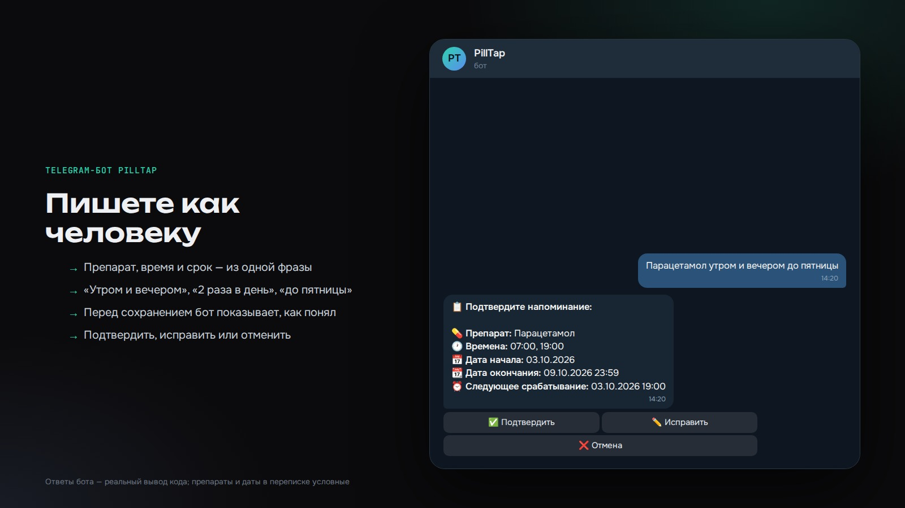
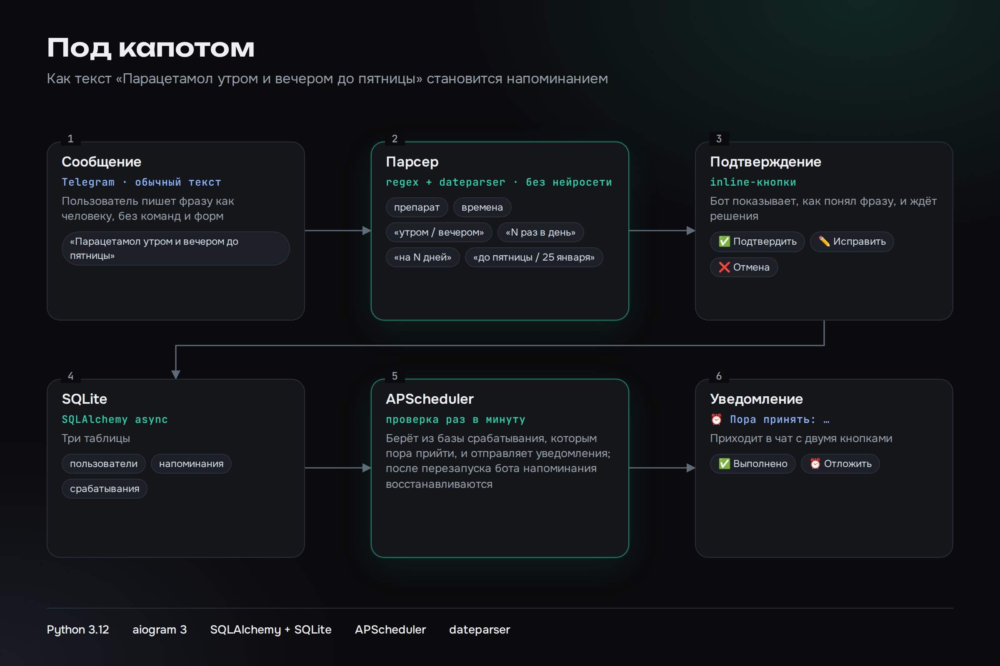

# PillTap — Telegram-бот напоминаний о приёме лекарств

Бот принимает обычную фразу на русском («Парацетамол утром и вечером до пятницы»), сам находит в ней препарат, время приёма и срок приёма, показывает, как понял, и после подтверждения ставит напоминания. В назначенное время приходит сообщение с кнопками «Выполнено» и «Отложить». Напоминания можно смотреть, править, ставить на паузу и удалять.

Фразы разбираются без нейросети: правила на регулярных выражениях плюс библиотека dateparser для дат. Поэтому разбор работает офлайн, мгновенно и одинаково на одинаковых фразах, а сторонним сервисам тексты не передаются. После перезапуска бота напоминания восстанавливаются из базы.





## Стек

Python 3.12, aiogram 3, SQLAlchemy (async) + SQLite, APScheduler, dateparser.

## Установка и запуск

```bash
python -m venv .venv && source .venv/bin/activate
pip install -r requirements.txt
cp .env.example .env      # впишите токен бота от @BotFather в BOT_TOKEN
python -m app.main
```

Переменные окружения: `BOT_TOKEN` (обязательная), `DATABASE_URL` (по умолчанию SQLite-файл `pilltap.db`), `TIMEZONE` (по умолчанию Europe/Moscow), `LOG_LEVEL` (по умолчанию INFO).

## Тесты

Тесты разбора фраз работают офлайн и не требуют токена:

```bash
pip install -r requirements-dev.txt
pytest
```

## Использование

### Команды

- `/start` - Начать работу с ботом, получить инструкцию

### Примеры ввода напоминаний

Бот понимает свободный текст на русском языке. Примеры:

**Простое напоминание:**
```
Напомни принимать Аспирин в 12:30
```

**С периодичностью:**
```
Називин 3 раза в день в течение 3 дней
```

**С временами дня:**
```
Парацетамол утром и вечером до пятницы
```

**С конкретными временами:**
```
Витамин D в 08:00 и 20:00 на неделю
```

**С датой окончания:**
```
Антибиотик 2 раза в день до 25 января
```

### Форматы времени

Бот распознаёт различные форматы времени:
- `12:30`, `12.30`, `12,30`, `12 30`, `12-30`
- `12ч30м`, `12h30`
- `1230` (если однозначно)

### Периодичность

- **"утро, обед, вечер"** → 07:00, 13:00, 19:00
- **"3 раза в день"** → 07:00, 13:00, 19:00
- **"2 раза в день"** → 09:00, 21:00
- Конкретные времена имеют приоритет

### Срок действия

- "до послезавтра", "до пятницы", "до пт/ср/вс"
- "на 3 дня", "в течение 3х дней", "на неделю", "на 10 дней"
- Конкретные даты: "до 25 января", "до 2025-01-25"

### Управление напоминаниями

- `/reminders` - Просмотр всех напоминаний с пагинацией
- На карточке напоминания доступны кнопки:
  - ✏️ Изменить (название/времена/срок)
  - ⏸ Пауза / ▶️ Продолжить
  - 🗑 Удалить

### Напоминания

Когда наступает время приёма, бот отправляет сообщение с кнопками:
- ✅ **Выполнено** - отметить приём как выполненный
- ⏰ **Отложить** - перенести напоминание (10 мин / 30 мин / 1 час / 2 часа / завтра / выбрать дату-время)

## Структура проекта

```
pilltap-bot/
  app/
    main.py              # Точка входа
    bot.py               # Инициализация Bot/Dispatcher
    config.py            # Конфигурация
    db/
      models.py          # SQLAlchemy модели
      session.py         # Сессии БД
    scheduler/
      apscheduler_setup.py  # Настройка планировщика
      jobs.py            # Задачи планировщика
    handlers/
      start.py           # Обработчик /start
      note_input.py      # Обработка ввода заметок
      reminders.py       # Управление напоминаниями
      callbacks.py       # Inline-колбэки
    services/
      parser.py          # Парсинг текста
      reminder_service.py # Бизнес-логика напоминаний
    keyboards/
      inline.py          # Inline-клавиатуры
      reply.py           # Reply-клавиатуры
    utils/
      datetime_utils.py  # Утилиты для работы с датами
  tests/                 # Тесты парсера
  docs/                  # Схема и скриншот
  .env.example
  requirements.txt
  README.md
```

## База данных

Бот использует SQLite с тремя основными таблицами:

- `users` - пользователи (id, tg_id, tz)
- `reminders` - напоминания (id, user_id, title, times_json, start_date, end_date, rule_type, is_active, created_at)
- `reminder_occurrences` - события напоминаний (id, reminder_id, planned_at, status, done_at, postponed_from)

## Логирование

Логи выводятся в консоль с уровнем, указанным в `.env` (по умолчанию INFO).

## Лицензия

MIT — см. [LICENSE](LICENSE).
